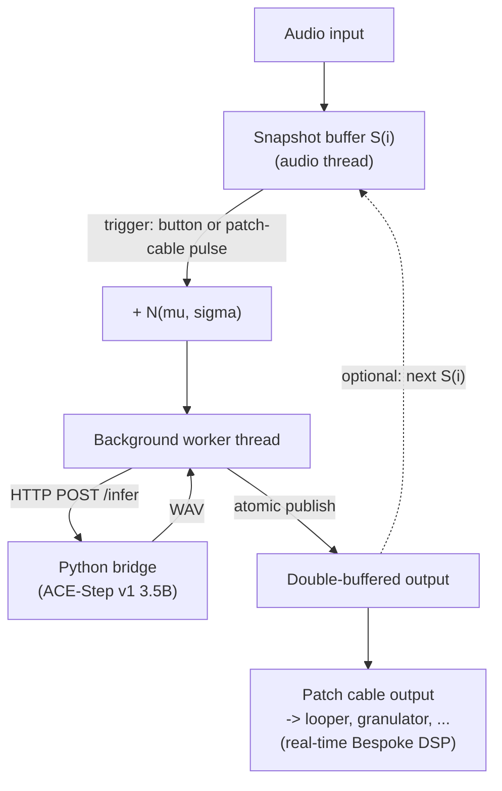

# Latent Resonator

**A recursive neural resampler, built as a custom module inside a fork of [Bespoke Synth](https://www.bespokesynth.com/).**

Latent Resonator captures audio, runs it through the ACE-Step music model, feeds the result back in, and repeats. Each pass regenerates the sound a little further from its source, so the model's own timbral tendencies (metallic, granular, smeared) accumulate. You audition the resulting takes and play with them using Bespoke Synth's own real-time nodes (looper, granulator, filters).

> *"We do not create music; we organize sound, and in the process, we allow the machine to reveal its own acoustic unconscious."*

## What it is, and what it is not

**It is** an asynchronous neural texture generator. One iteration takes seconds on the current bridge (see [Measured performance](#measured-performance)). You trigger it, wait, and get a take back.

**It is not** a real-time effect. Neural inference does not run in the audio path and cannot run at audio rate. Earlier drafts of this project claimed "<200 ms" and "<5 ms" neural latency; those claims were wrong and have been removed. Only Bespoke Synth's own DSP nodes are real-time.

**It does not preserve your input.** At `input_strength` 0.6 the output is largely regenerated: measured waveform correlation with the input was approximately zero. Think "resampled through a model's imagination," not "processed."

Other limits, up front:

- Verified only on Apple Silicon macOS. Nothing else has been tested.
- Bespoke Synth has no plugin system, so this is a whole-app fork, not an add-on. There is no packaged download yet.
- Model weights are never bundled. You download them yourself (~16 GB).
- Interactive use of the module has had a first hands-on pass only; expect rough edges.

## How the recursion works

```
S(i+1) = ACE( S(i) + N(mu, sigma), P, gamma )
```

| Symbol | Meaning |
|---|---|
| `S(i)` | Audio at iteration `i` (S(0) is the captured input) |
| `N(mu, sigma)` | Gaussian noise added before the model sees the audio |
| `P` | Text prompt (semantic conditioning) |
| `gamma` | Sent to the bridge as `denoise_strength`, which scales the number of diffusion steps (`round(num_steps * gamma)`). How much of the input survives is governed separately by the bridge's `input_strength` (default 0.6), which the module does not yet expose |

Each pass is an audio-to-audio diffusion run: the input is partially noised and the model denoises it toward the prompt. Feeding the output back makes the whole system behave like a feedback loop with a nonlinear, learned "filter" in it. The [whitepaper](docs/whitepaper.md) covers the theory (Lucier's *I Am Sitting in a Room*, SDEdit-style partial denoising, model-collapse literature) and lists the hypotheses we still have to test.

## Architecture

Two clocks, deliberately separated:

- **Slow neural layer** (seconds to minutes): the ACE-Step model, running in a Python subprocess.
- **Fast DSP layer** (audio rate): Bespoke Synth's stock nodes, where you audition and perform the takes.



- **Module** (`bespoke-migration/module/`): C++ module registered in Bespoke as `latentresonator`. Neural inference is isolated from both the audio and UI threads.
- **Bridge** (`bespoke-migration/ace-bridge/`): standalone Python HTTP server that wraps ACE-Step. It binds to `127.0.0.1` only and has no authentication; do not expose it to a network.

Build details, including the exact registration diffs against a Bespoke checkout, are in [`bespoke-migration/module/BUILD_VERIFICATION.md`](bespoke-migration/module/BUILD_VERIFICATION.md).

## Requirements

| Requirement | Detail |
|---|---|
| Machine | Apple Silicon Mac (the only platform verified) |
| Python | 3.12 virtual environment for the bridge |
| Disk | ~16 GB for ACE-Step weights (not bundled) |
| Toolchain | CMake and Xcode Command Line Tools, to build Bespoke Synth |
| Model | ACE-Step v1 3.5B is what the bridge loads |

The `acestep-v15-turbo` folder that some downloads contain has no weights in our setup, and the turbo variant is not usable here.

## Try it (standalone zip)

`scripts/package_macos.sh` assembles `LatentResonator-<version>-macOS-arm64.zip`: the fork's `BespokeSynth.app`, the bridge, an example patch, licenses and a source offer. It is ad-hoc signed, not notarized, and there is no public download yet. Its `QUICKSTART.txt` has the exact steps; in short:

1. `cd ace-bridge && ./setup_ace_bridge.sh --with-model` creates the Python 3.12 venv and `models/ace-step/`, and the bridge downloads the ~7.7 GB checkpoint on first load. Stop it with Ctrl+C when the model is ready.
2. Optionally load `examples/latent_resonator_demo.json` (copy it to `~/Documents/BespokeSynth/layouts/` and set `"layout"` in `~/Documents/BespokeSynth/userprefs.json`), or wire `signalgenerator` -> `latentresonator` -> `gain` -> outputs by hand.
3. Open the app. The module starts its own bridge and finds the weights in `models/ace-step` next to the app (or in `LATENT_RESONATOR_MODEL_PATH`). Raise `vol` on the signal generator, then press `regenerate`.

What was verified for the zip layout: the module finds the bridge script, the venv and the weights by itself, and the bridge reports the model loaded in float16 on MPS. The example patch loads with all cables wired. Not verified by hand: audio playback, the progress bar during a run, iterate/cancel, and save/load of the patch.

### Module controls

| Control | Effect |
|---|---|
| `prompt` | Text conditioning |
| `input strength` | Bridge `input_strength` (0-1, default 0.6): how much of the input the model keeps before denoising |
| `steps`, `guidance`, `seed` (`lock seed`) | Diffusion steps, guidance scale, seed (-1 = random) |
| `gamma (step scale)` | Bridge `denoise_strength`; scales the number of steps actually run |
| `noise mu` / `noise sigma` | Gaussian noise added to the snapshot before each pass |
| `iterate`, `cancel` | Feed each take back as the next input, up to N times |
| `dry monitor`, `out gain dB`, `normalize take`, `loop take` | Hear the live input, adjust level, normalize to about -3 dBFS, loop the last take |
| `regenerate` (button or pulse input) | Snapshot the input and start a take |

## Quick start (build)

Bespoke Synth has no plugin system, so every module is compiled into the one binary. This repository does not vendor Bespoke's source tree; it owns only the module and the bridge.

```bash
git clone https://github.com/BespokeSynth/BespokeSynth
cd BespokeSynth
git submodule update --init --recursive
cmake -Bignore/build -DCMAKE_BUILD_TYPE=Release

# Copy this repo's module in, then wire it up as documented in
# bespoke-migration/module/BUILD_VERIFICATION.md:
#   - copy ModuleACEResonator.h / .cpp into Source/
#   - add the #include and this line to Source/ModuleFactory.cpp:
#       REGISTER(ModuleACEResonator, latentresonator, kModuleCategory_Synth);
#   - add both filenames to target_sources() in Source/CMakeLists.txt

cmake --build ignore/build --target BespokeSynth --parallel 4 --config Release

# Place the bridge next to the built app:
cp -R /path/to/this/repo/bespoke-migration/ace-bridge ./ace-bridge
```

The result is `ignore/build/Source/BespokeSynth_artefacts/Release/BespokeSynth.app`. Set up the bridge's Python 3.12 venv and place ACE-Step weights as described in [`bespoke-migration/ace-bridge/`](bespoke-migration/ace-bridge/). Bridge tests:

```bash
pytest bespoke-migration/ace-bridge/test_bridge.py -v
```

Known gap: the module ports the bridge launch, health-check and shutdown lifecycle, but not the old app's automatic dependency install and repair logic. See `BUILD_VERIFICATION.md`.

## Measured performance

Measured on an Apple Silicon Mac (32 GB) with the MPS backend, ACE-Step v1 3.5B, 8 diffusion steps, `input_strength` 0.6. The machine was under heavy load during every run (load average 8-15), so treat these as indicative, not benchmarks. The bridge's own [Performance notes](bespoke-migration/ace-bridge/README.md) have the full table and method.

| Bridge configuration | 3 s of audio (wall time) | Real-time factor |
|---|---|---|
| Original: float32, no warm-up | 39-57 s | ~14x slower than real time |
| Current: float16, `--warmup` | ~1.1 s warm (2-7 s on the first calls) | ~0.4 (faster than real time) |

| Current bridge, warm | Wall time |
|---|---|
| 10 s of audio | ~2.4 s |
| 30 s of audio | ~7-8 s |
| Model load | ~60 s, plus a cold first request when weights are not in the OS page cache |

What changed: on MPS, ACE-Step forces float32, which puts the model at roughly 14 GB. On a shared 32 GB machine that showed up as 20+ s of stalls in the small conditioning step of every call. Running in float16 removed the stalls. The cause is inferred from timings, not proven, and float16 output quality was checked only by correlation with float32 (0.88 for the same seed) and level, not by ear.

Practical consequence: takes are seconds, not minutes, so iterating a loop of ten passes is on the order of tens of seconds. That is still an asynchronous batch process, not a real-time effect: it does not run at audio rate and cannot be played live.

Observed quirks: float16 outputs were quiet (RMS roughly 0.01-0.03 against an input RMS of 0.13), so expect to add gain; and output is largely regenerated (waveform correlation with the input approximately zero at `input_strength` 0.6).

## Roadmap

1. **Truth and hygiene**: done. Claims corrected, Swift app removed (source at tag `swift-app-final`), licensing settled.
2. **Engine**: done for the bridge (float16, warm-up, progress endpoint, benchmark harness). Still open: dependency repair from inside the module, and hand-testing the module's GUI workflow.
3. **Science experiments**: generator and first data exist (`demos/make_demo.py`; a single-seed `input_strength` sweep hints at a change of regime between 0.4 and 0.6, not resolved with four points). Open: more seeds, a codec-only control, and CLAP-based metrics.
4. **Nodes and Take Strip**: open. Today a single module holds the loop and the last take; a Take Strip to browse, compare and route takes is next.
5. **Performance layer**: open. Prefab, macro slider and snapshots around the module, plus more example patches.
6. **Release**: the zip builds locally; the tag-triggered release workflow has not been run. No public download yet.

No dates are committed.

## Licensing

| Component | License |
|---|---|
| Bespoke Synth (upstream) | GPL-3.0 |
| `latentresonator` module (compiled into the fork) | GPL-3.0 |
| Python bridge (`bespoke-migration/ace-bridge/`) | MIT |
| Documentation | MIT |
| ACE-Step code | Apache-2.0 (read from the upstream `LICENSE`, 2026-09-29) |
| ACE-Step v1 3.5B weights | MIT, as declared in the model card that ships with the checkpoint (read 2026-09-29) |

Any binary distributed from the fork must make the fork's full source available under GPL-3.0. Re-check the ACE-Step licenses before each release. Statements about ACE-Step's training-data provenance are claims made by its authors; we have not verified them. Copyright holder of this repository: UNBRANDED. See [LICENSE](LICENSE) and [CONTRIBUTING.md](CONTRIBUTING.md).

## Legacy Swift app

The original SwiftUI/AVAudioEngine app was retired and removed from the tree. Its distilled knowledge (algorithms, parameters, bridge lifecycle, lessons learned) is in [`docs/LEGACY_SWIFT_LEARNINGS.md`](docs/LEGACY_SWIFT_LEARNINGS.md); the full source is in git history under the tag `swift-app-final`. The migration rationale is in [`docs/MIGRATION_BESPOKE_SYNTH_2026-09-11.md`](docs/MIGRATION_BESPOKE_SYNTH_2026-09-11.md).

## Credits

- [Bespoke Synth](https://github.com/BespokeSynth/BespokeSynth) by Ryan Challinor and contributors (GPL-3.0): the host, audio engine and UI.
- [ACE-Step](https://github.com/ace-step/ACE-Step): the music-generation model (ACE-Step Team, "ACE-Step: A Step Towards Music Generation Foundation Model", 2025).
- Conceptual lineage: Alvin Lucier, *I Am Sitting in a Room* (1969); Iannis Xenakis, *Formalized Music*; Pierre Schaeffer; Curtis Roads, *Microsound*; G. M. Koenig; G. Toussaint (Euclidean rhythms).
- Full references in the [whitepaper](docs/whitepaper.md).

## Contributing

This is our own fork. Nothing is pushed to or proposed upstream to Bespoke Synth. Issues and pull requests against this repository are welcome; read [CONTRIBUTING.md](CONTRIBUTING.md) first. Contributions to the bridge and docs are MIT; contributions to the module are GPL-3.0.
