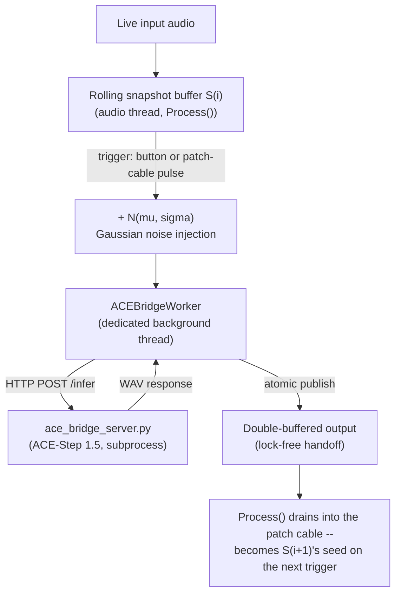
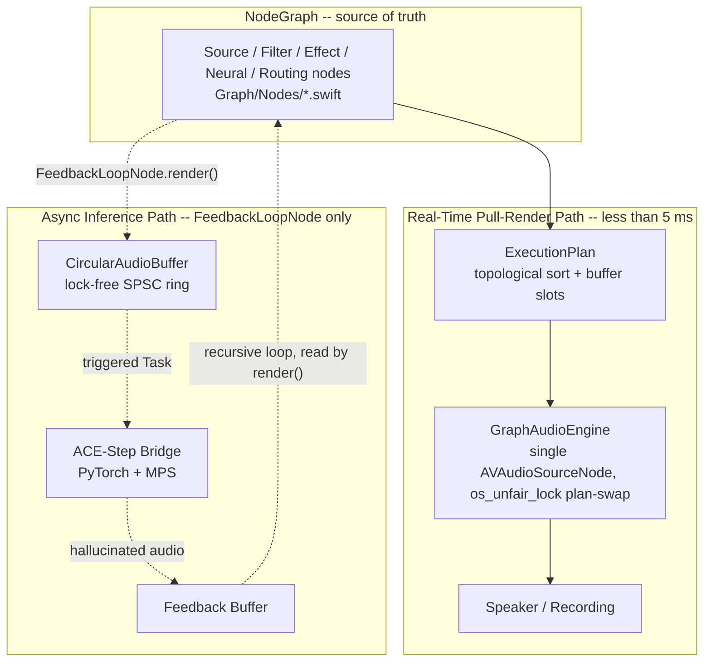

# Latent Resonator

[](https://github.com/U-N-B-R-A-N-D-E-D/Latent-Resonator/actions/workflows/ci.yml)
[](LICENSE)
[]()
[]()
[]()
[](CHANGELOG.md)

**A Non-Linear Spectral Processor powered by recursive neural inference and dataflow architecture.**

Latent Resonator transforms the ACE-Step 1.5 neural audio synthesis architecture into an executable instrument. Instead of generating songs, it establishes a *Neural Feedback Loop*--where inference output feeds back as input--inducing **generative degradation** that reveals the latent timbral biases of the neural network.

Grounded in the avant-garde traditions of Musique Concrète (Schaeffer), Stochastic Synthesis (Xenakis), Microsound (Roads), and Algorithmic Composition (Koenig), the system treats a diffusion model not as a composer but as a **Black Box Resonator**.

> *"We do not create music; we organize sound, and in the process, we allow the machine to reveal its own acoustic unconscious."*

## Project Status

This repo's code (`MARKETING_VERSION` 2.0.0) is the pull-render node-graph
rewrite -- **STAGES** (native node+cable patch canvas, `PatchCanvasView`) and
**PERFORM** (Motherbase performance surface) modes, described in full below.
It has never been tagged or published as a GitHub release; the
[Releases page](https://github.com/U-N-B-R-A-N-D-E-D/Latent-Resonator/releases)
still only offers v1.0.4, built from the older lane-based architecture
(`main`). There is no separate SETUP tab or `LaneStripView` in this codebase
-- the node graph is the architecture.

On top of that, this repository is now migrating away from the custom
native canvas entirely, toward a **fork of [Bespoke Synth](https://www.bespokesynth.com/)**,
an actively maintained, open-source (GPL-3.0) modular synthesizer with a
proven node-based UI, used here as our own foundation -- this is not a
contribution back to the upstream project. STAGES was the source of most UX
friction (rendering lag, no smooth cable/node interaction); the neural
feedback loop itself -- the actual research contribution -- is being
carried over, not rebuilt. See [`docs/MIGRATION_BESPOKE_SYNTH_2026-09-11.md`](docs/MIGRATION_BESPOKE_SYNTH_2026-09-11.md)
for the full plan.

**Done and verified, against this v2.0.0 code specifically:**
- [`bespoke-migration/ace-bridge/`](bespoke-migration/ace-bridge/) -- the ACE-Step Python bridge, extracted into a standalone, host-agnostic package (15 passed, 1 correctly skipped without a live GPU checkpoint).
- [`bespoke-migration/module/`](bespoke-migration/module/) -- `ModuleACEResonator`, a Bespoke Synth module implementing the `S(i+1) = ACE(S(i) + N(mu,sigma), P, gamma)` recursion. Compiled clean and folded into a real local Bespoke Synth fork build (not just a scratch test), launched, and confirmed running stable with a real audio session initialized, no crash, clean shutdown with no orphaned processes (see [`BUILD_VERIFICATION.md`](bespoke-migration/module/BUILD_VERIFICATION.md)). Known gap: it ports the core subprocess/health-check/shutdown lifecycle from `BridgeProcessManager.swift`, but not that file's more elaborate auto-install/dependency-repair retry logic -- flagged there as follow-up work, not silently dropped.
- The legacy app itself: Debug build succeeds clean, the full private test suite passes 122/122, and a `2.0.0` release zip builds correctly (ad-hoc signed, matching CI's own packaging steps).
- SIGTERM/SIGINT now properly terminate the Python bridge subprocess (see the "Fixed" note in [`CHANGELOG.md`](CHANGELOG.md)) -- a bug found and closed during this verification pass, not left open.

**Pending:** actually clicking through and exercising `ModuleACEResonator`'s
UI interactively (prompt entry, trigger, live inference) -- everything
verified so far is process-level (compiles, launches, stays alive, shuts
down clean), not a hands-on functional test of the module itself. No
packaged release exists yet, on purpose -- the fork stays a local build
until that interactive pass happens. Bespoke Synth's code is GPL-3.0 -- any
binary eventually distributed from this fork must make that fork's full
source available.

Screenshots have been removed from this README: the existing image files
predate this v2.0.0 rewrite and don't actually depict the current
STAGES/PERFORM UI, even though earlier captions described it that way. New
screenshots will follow once the Bespoke Synth module lands, since the
native canvas they would otherwise show is itself being retired.

---

## Audio Demo

**Texture Improvisation** -- 14 minutes 47 seconds of a live recursive session, unedited.
Euclidean impulses (Koenig Seed) enter the Neural Feedback Loop and emerge as self-organizing metallic textures, spectral drones, and granular artifacts.

[**Listen: latent_resonator_texture_improv.mp3**](docs/audio/latent_resonator_texture_improv.mp3) *(48 kHz stereo, 31 MB, 14m 47s)*

*Mastered to -15 LUFS integrated with brick-wall limiter at -0.1 dBTP.*

---

## Download

Pre-built macOS apps are available in [Releases](https://github.com/U-N-B-R-A-N-D-E-D/Latent-Resonator/releases). Download the zip, unzip, and drag `LatentResonator.app` to Applications (or run from anywhere).

**If macOS says the app is "damaged":** Gatekeeper blocks unsigned downloads. In Terminal:
```bash
xattr -cr /path/to/LatentResonator.app
```

---

## Bespoke Synth Module (Active Development)

`ModuleACEResonator` reimplements the same recursion inside Bespoke Synth,
with the slow, CPU-bound neural inference fully isolated from both the audio
thread and the UI thread:



Source: [`bespoke-migration/module/ModuleACEResonator.h`](bespoke-migration/module/ModuleACEResonator.h) / [`.cpp`](bespoke-migration/module/ModuleACEResonator.cpp). Build verification, including the exact registration diffs against a real Bespoke Synth checkout: [`BUILD_VERIFICATION.md`](bespoke-migration/module/BUILD_VERIFICATION.md).

### Not a plugin -- this is a whole-app fork

Bespoke Synth has no plugin/dynamic-module system: every module, including
this one, is compiled directly into the single Bespoke Synth binary. There
is no "install Bespoke, then add Latent Resonator" step -- running
`ModuleACEResonator` means running *our specific build* of the entire
Bespoke Synth app (JUCE audio engine, every stock module, plus this one),
not vanilla Bespoke Synth from bespokesynth.com.

**No packaged download exists yet, deliberately** -- the fork currently
lives only as a local build on one machine, not published anywhere. This
repository does not, and should not, vendor Bespoke Synth's full source
tree (JUCE + submodules, several GB) into its own git history -- that's an
external GPL-3.0 project, not our code. What this repository *does* own is
`bespoke-migration/` (the module source and the extracted bridge), which is
everything needed to reproduce the fork:

```bash
git clone https://github.com/BespokeSynth/BespokeSynth
cd BespokeSynth
git submodule update --init --recursive
cmake -Bignore/build -DCMAKE_BUILD_TYPE=Release

# Copy this repo's module in, then wire it up exactly as documented in
# bespoke-migration/module/BUILD_VERIFICATION.md:
#   - copy ModuleACEResonator.h / .cpp into Source/
#   - add the #include + REGISTER(...) line to Source/ModuleFactory.cpp
#   - add the two filenames to Source/CMakeLists.txt's target_sources()

cmake --build ignore/build --parallel 4 --config Release
cp -R ../latent-resonator/bespoke-migration/ace-bridge ./ace-bridge  # sits next to the built .app
```

The resulting `BespokeSynth.app` is the whole distributable -- when a
packaged `.zip` release does get published, it will be this same app plus
its `ace-bridge/` folder, the same shape as the legacy Swift app's own
releases (app + bridge script, model weights always separate).

---

## Architecture (Legacy Swift App, v2.0.0)

This section documents the native macOS app as it exists today. It is frozen
-- no further UI work is planned -- and is kept here for historical reference
while the Bespoke Synth module above becomes the primary target.

The system runs on two independent clocks. The **real-time DSP path** renders through a pull-render node graph at buffer rate (<5 ms latency): a single `AVAudioSourceNode`, owned by `GraphAudioEngine`, walks a pre-built `ExecutionPlan` and calls `DSPNode.render(...)` on every participating node in the patch (same model as Reaktor/Max/VCV Rack -- AVAudioEngine itself is only used for I/O). The **async inference path** sends captured audio to ACE-Step in the background (seconds per cycle, triggered from inside `FeedbackLoopNode`, never blocking render) and feeds the result back into the mix. When no neural bridge is connected, the DSP path degrades gracefully to passthrough -- the "Black Box Resonator."



### Core Components

| Component | File | Purpose |
|---|---|---|
| **Neural Engine** | `NeuralEngine.swift` | Owns the NodeGraph, GraphAudioEngine, ACE-Step bridge, scenes, and parameter routing |
| **Node Graph** | `Graph/NodeGraph.swift` | Source of truth: nodes, edges, exposed controls, validation, serialization |
| **Graph Audio Engine** | `Graph/Engine/GraphAudioEngine.swift` | Pull-render engine: single AVAudioSourceNode, atomic ExecutionPlan swap |
| **Execution Plan** | `Graph/Engine/ExecutionPlan.swift` | Topological sort of the graph into a render order + buffer-slot assignment |
| **DSP Node Protocol** | `Graph/Engine/DSPNode.swift` | The real-time interface every render-participating node implements |
| **Graph Nodes** | `Graph/Nodes/*.swift` | Source, filter/effect, neural, control, routing, sequencer, analysis node implementations |
| **Sequencer Engine** | `SequencerEngine.swift` | Step grid state, advance logic, BPM, chain length |
| **Scene Manager** | `SceneManager.swift` | Scene bank, apply/capture, crossfade blending |
| **ACE-Step Bridge** | `ACEStepBridge.swift` | Swift async HTTP client for the Python bridge server |
| **WAV Codec** | `WAVCodec.swift` | WAV encoding/decoding for audio-to-HTTP transport |
| **Signal Generator** | `SignalGenerator.swift` | Multi-source excitation signals (noise, sine, impulses, mic input) |
| **Koenig Seed** | `KoenigSeedGenerator.swift` | Generates Euclidean rhythm E(5,13) Dirac impulses with Gaussian noise tails |
| **Circular Buffer** | `CircularAudioBuffer.swift` | Lock-free SPSC ring buffer for audio-to-inference thread communication |
| **Bridge Process Mgr** | `BridgeProcessManager.swift` | Manages Python bridge lifecycle: venv creation, deps, server launch, model auto-discovery |
| **Audio Recorder** | `AudioRecorder.swift` | Master recording to WAV in Documents |
| **Bridge Server** | `ace_bridge_server.py` | Python HTTP server wrapping ACE-Step 1.5 inference |
| **Design System** | `Config/Constants.swift` (`DS` enum) | Centralized design tokens: typography scale, semantic colors, spacing, radii |
| **UI Components** | `Views/LRComponents.swift` | Reusable SwiftUI primitives: LRToggle, LRSegmentPicker, LRStatusRow, LRActionButton, LRParamSlider, LRSectionHeader, LRDivider |
| **UI Views** | `Views/` | SwiftUI views: `Views/Patch/PatchCanvasView` (Canvas), `PerformanceMotherbaseView` (Perform), RetroKnob, LatentXYPad, SceneCrossfaderView |

### The Neural Feedback Loop

```
S(i+1) = ACE( S(i) + N(μ,σ), P, γ )
```

- **S(i)** -- audio signal at iteration *i*
- **N(μ,σ)** -- Gaussian noise (controlled by `inputStrength`)
- **P** -- abstract prompt vector (evolves across iterations)
- **γ** -- Guidance Scale / CFG (15.0–18.0 to overdrive the renderer)

---

## Requirements

| Requirement | Minimum | Recommended |
|---|---|---|
| **Chip** | Apple M1 | M1 Pro / M2 / M3 |
| **RAM** | 8 GB unified | 16 GB unified |
| **OS** | macOS 14.0 (Sonoma) | macOS 15 (Sequoia) |
| **Xcode** | 15.0+ | 15.4+ |
| **Python** | 3.10+ *(bridge server only, optional)* | 3.11 |
| **Disk** | ~200 MB (app) | ~7 GB (with ACE-Step model weights) |
| **Microphone** | Required for live audio input | -- |

### Portability & Security

The project is designed to run on any Mac without machine-specific paths or secrets:

- **Paths**: Model directory defaults to `~/Documents/LatentResonatorModels/`; recordings to `~/Documents/LatentResonator/`. Both configurable in Settings > Config.
- **Bridge**: Binds to `127.0.0.1` only (local use). No authentication; do not expose to the network.
- **Secrets**: No API keys or credentials in the repo. `.gitignore` excludes `.env`, `*.key`, `*.pem`.
- **Python venv**: App creates `~/Library/Application Support/LatentResonator/venv-ace-bridge/` (user-writable; fixes "Failed to create venv" when app is in /Applications or read-only locations).

### Optional: Core ML Models

The app gracefully degrades to DSP-only processing (Black Box Resonator mode) if Core ML models are not present. To enable full neural inference:

1. Run the conversion script:
   ```bash
   cd LatentResonator/LatentResonator/Scripts
   pip install -r requirements.txt
   python convert_ace_to_coreml.py
   ```
2. Copy the generated `.mlpackage` files to `LatentResonator/Resources/`

### ACE-Step Bridge Server (Recommended)

The ACE-Step Bridge provides a Python HTTP server that wraps ACE-Step 1.5 inference, allowing the Swift app to offload neural processing to PyTorch with MPS (Metal) acceleration.

```
┌─────────────────────┐    HTTP/JSON     ┌─────────────────────┐
│   Latent Resonator  │  <──────────>   │  ACE-Step Bridge    │
│   (Swift / macOS)   │    base64 WAV    │  (Python / PyTorch) │
│                     │                  │                     │
│  • DSP Processor    │    /health       │  • ACE-Step 1.5     │
│  • Feedback Loop    │    /infer        │  • MPS/CUDA accel   │
│  • Vectorscope (TBD)│    /status       │  • Passthrough mode │
└─────────────────────┘                  └─────────────────────┘
```

**Quick Start (passthrough mode -- no model download needed):**

```bash
cd LatentResonator/LatentResonator/Scripts
./setup_ace_bridge.sh
```

This creates a Python virtual environment, installs dependencies, and starts the bridge server on `http://127.0.0.1:8976`. The Swift app will auto-detect it via health polling.

**With full model download (~7GB):**

```bash
./setup_ace_bridge.sh --with-model
```

**With an existing model:**

```bash
./setup_ace_bridge.sh --start-only --model-path /path/to/ace-step-model
```

**Manual setup (without script):**

```bash
# Create virtual environment
python3 -m venv .venv-ace-bridge
source .venv-ace-bridge/bin/activate

# Install dependencies
pip install -r LatentResonator/LatentResonator/Scripts/requirements_bridge.txt

# Start server (passthrough mode)
python LatentResonator/LatentResonator/Scripts/ace_bridge_server.py

# Start server (with model)
python LatentResonator/LatentResonator/Scripts/ace_bridge_server.py \
  --model-path ACE-Step/Ace-Step1.5
```

**Local use only:** The bridge binds to `127.0.0.1` by default and is intended for use on the same machine as the app. Binding to `0.0.0.0` or a network interface exposes unauthenticated endpoints; use only in trusted environments.

### Performance Mode Optimization

When switching to **PERFORM** mode, the app automatically restarts the Python bridge with the `--low-latency` flag:

- **Inference steps capped at 6** (vs default 8-20)
- **Faster iteration cycles** for real-time performance
- **Lower quality but higher responsiveness** — trade visual polish for speed

This happens transparently via `BridgeProcessManager.launchServer(performanceMode: true)`. The terminal console in Canvas mode will show:

```
Low-latency mode enabled: capping steps to 6
```

Switching back to Canvas mode restarts the bridge without the flag, restoring full-quality inference.

The bridge server has three operating modes:
| Mode | When | Behavior |
|---|---|---|
| **Passthrough** | No model loaded | Echoes audio back; Swift DSP processes it |
| **Neural Inference** | Model loaded | Full ACE-Step pipeline on MPS/CUDA/CPU |
| **Disconnected** | Server not running | Swift app uses DSP-only fallback |

---

## Build from Source

```bash
# Open in Xcode
open LatentResonator/LatentResonator.xcodeproj

# Or build from command line
cd LatentResonator
xcodebuild -project LatentResonator.xcodeproj \
           -scheme LatentResonator \
           -destination 'platform=macOS' \
           build
```

### First Launch

1. **Grant microphone access** when prompted.
2. Wait for the ACE-Step bridge to initialize (loading model weights).
3. Press **START** to begin the feedback loop. The loop runs silent (or passthrough) — *listen before you adjust*.
4. Press **K** (or the SEED button) to manually inject the Koenig Seed (Euclidean rhythm of Dirac impulses). The performer arms the seed deliberately, not automatically.
5. Adjust parameters in real-time to steer the generative degradation.

### Two Interaction Modes

The app has two modes (top bar: **CANVAS** | **PERFORM**). Cycle with `Tab`.

- **CANVAS** -- Native SwiftUI node-graph canvas (`PatchCanvasView`, no WebView). Build and play in the same surface: a LOCK/UNLOCK toggle gates structural editing without switching views. Right-click to add nodes, drag cables between port chips, real-time terminal console for Python bridge logs.
- **PERFORM** -- Fixed Motherbase surface: scenes (A/B crossfader), Elektron-style step sequencer, focus lane, auto-generated control surface. Same controls in the same place for muscle memory.

### Terminal Console (Canvas Mode)

The Canvas view includes a collapsible terminal console at the bottom showing live output from the Python bridge server:

- **Real-time logs** — stdout/stderr from `ace_bridge_server.py`
- **Status indicator** — RUNNING / LAUNCHING / ERROR
- **Auto-scroll toggle** — Follow latest output or scroll freely
- **Mecha Metal aesthetic** — Phosphor green monospaced text on black
- **Bounded history** — Last 100 lines kept in memory

Use the terminal to debug bridge issues, monitor inference cycles, and verify model loading.

### Audio Visualizer (Perform Mode)

`AudioVisualizerXYPad` provides a real-time audio visualizer alongside the Perform surface:

- **Waveform + FFT display** — Canvas 2D rendering of audio signal and spectrum
- **Touch-reactive** — Still controls Texture and Chaos macros via drag
- **Lightweight** — ~20KB memory footprint, 30fps throttled updates
- **Fade trails** — Visual feedback of parameter changes

### Step Sequencer (Perform View)

The step grid is an Elektron-inspired pattern sequencer with **parameter locks (P-Locks)**, **trig types**, and a configurable **chain length**.

**Trig Types** (set via right-click context menu on any step pad):

| Trig | Color | Behavior |
|---|---|---|
| **Note** | Red | Normal trigger -- fires audio + applies P-Locks |
| **Lock** (Trigless) | Yellow | Applies P-Locks without triggering a new note |
| **One-Shot** | Green | Fires once per pattern cycle, then skips until wrap |
| **Skip** | Gray | Step is silenced entirely |

**14 Lockable Parameters** (per-step, via knob manipulation while a step is selected):

| Category | Parameters |
|---|---|
| Primary (always visible) | CFG, Feedback, Filter Cutoff, Warmth |
| Secondary (shown during P-Lock editing) | Texture, Chaos, Delay Mix, BitCrush Depth |
| Additional | Prompt Phase, Denoise Strength, Filter Resonance, Excitation Mode, Entropy |
| Drum Lane | **DrumVoice** (kick, snare, hat, cymbal, mixed) — per-step prompt override for percussion character |

**Drum Lane**: Add a lane with the "DRUM LANE" preset. Use the DRUM row in the P-Lock header to lock kick/snare/hat/cymbal/mixed per step. The prompt steers the next inference cycle toward that percussion character. One lane, no extra synthesis. See whitepaper §2.10.

**Multi-Select (Shift+Click)**: Hold Shift and tap steps to select multiple. When 2+ steps are selected, a batch bar appears: apply trig type, DrumVoice, or Clear All to the selection. Clears when you switch lanes.

**P-Lock Editing**: Tap a step pad to enter edit mode. All knobs become context-aware (showing an `[L]` suffix and orange accent). A secondary knob row appears for extended parameters. The header bar provides trig type selection, DrumVoice picker (Drum Lane), probability slider, and copy/paste/clear actions.

**Chain Length**: Configurable 1--16 steps via the `LEN` stepper. Steps beyond the chain length are dimmed and inactive.

**Probability Gate**: Per-step probability (0--100%). Steps with probability < 100% fire stochastically.

**Step Advance Modes**: time-based, iteration-based, or manual.

### Drum Lane Tips (Getting Clearer Kick / Snare)

ACE-Step produces timbral *suggestions*, not literal 808 samples. The DrumVoice prompt steers the texture; these tips help:

- **Filter P-Lock per step**: Lock a low cutoff (100–300 Hz) on kick steps, mids (800–3k) on snare, highs (4k+) on hat. Combines with DrumVoice for clearer separation.
- **Lower feedback** (0.3–0.4) for tighter transients; higher (0.6+) for smeared, evolving textures.
- **Step advance = TIME + BPM**: If using iteration-based advance, each "step" lasts ~20s (one inference cycle). Use TIME mode at 60–120 BPM so steps change faster and you hear more prompt variety.
- **Rhythm vs timbre**: The Koenig seed provides the pulse; the DrumVoice affects the *character* of the next inference. Timbral change lags ~20s (inference time). Expect texture to evolve slowly, not hit-per-hit.
- **BUCHLA PERC** preset: Also Koenig-based, sometimes more percussive. Try it, add DrumVoice P-Locks on top.

**Layer Carving (§2.11)**: Each preset occupies a distinct frequency slot so lanes don't blend into one "reverberant landscape." FERROFLUID DRONE stays sub (LP 120 Hz), NOISE SCAPE is air-only (HP 2.5 kHz), etc. Polarized prompts ("NO bass", "NO air") push the model toward opposite latent regions. Combine lanes for a layered mix with clear separation.

Scenes and the step grid are aligned with the whitepaper recursive formula (§3.3, §4.2.2).

---

## Settings

Use **Cmd + ,** or the gear icon in the mode bar to open Settings. Configure:

| Setting | Default | Description |
|---|---|---|
| **ACE-Step Model Path** | `~/Documents/LatentResonatorModels/` | Directory containing ACE-Step model weights. Use Browse to select a custom location. |
| **Recording Output Directory** | `~/Documents/LatentResonator/` | Where master WAV recordings are saved. Use Browse to select a custom location. |
| **Bridge Port** | 8976 (read-only) | Local port for the Python bridge server |

### Model Path Discovery

The app searches for model weights in this order:

1. **Custom path** (if configured in Settings)
2. **Documents** (`~/Documents/LatentResonatorModels/`) — default, user-visible
3. **Application Support** (`~/Library/Application Support/LatentResonator/Models/`)
4. **Project root** (`{projectRoot}/models/`) — developer convenience

Place your downloaded ACE-Step weights in any of these locations. The app creates the default directories automatically on first launch.

---

## Keyboard Shortcuts

All major actions are reachable without a mouse. Also documented in Settings > SHORTCUTS.

### Transport

| Key | Action |
|---|---|
| `Space` | Start / Stop engine |
| `Escape` | Panic -- force stop all lanes |
| `R` | Toggle master recording (saves to configured directory; default `~/Documents/LatentResonator/`) |

### Navigation

| Key | Action |
|---|---|
| `Tab` | Cycle modes: CANVAS ↔ PERFORM |
| `Cmd + ,` | Open Settings |
| `[` / `]` | Focus previous / next lane |

### Focus Lane

| Key | Action |
|---|---|
| `M` | Mute / unmute focus lane |
| `S` | Solo / unsolo focus lane |
| `F` | Toggle spectral freeze |

### Scenes

| Key | Action |
|---|---|
| `1` -- `8` | Load scene to A-side |
| `Shift + 1` -- `8` | Load scene to B-side |
| `Left` / `Right` | Nudge crossfader toward A / B |

### Sequencer

| Key | Action |
|---|---|
| `.` | Manual step advance (TAP) |
| `,` | Decrease chain length |
| `Shift + .` | Increase chain length |
| `Up` / `Down` | BPM +/- 10 (TIME mode) |

### Input Methods

All knobs respond to **vertical drag** and **scroll wheel / trackpad**. All sliders respond to **scroll wheel / trackpad**. Sensitivity: 0.3% of parameter range per scroll point.

---

## MIDI CC Map

Latent Resonator listens on all connected MIDI sources (class-compliant USB, network MIDI). CC messages route to the focus lane. Toggle parameters: CC < 64 = OFF, CC >= 64 = ON.

| CC | Parameter | Range |
|---|---|---|
| 20 | Volume | 0.0 -- 1.0 |
| 21 | Guidance Scale (CFG) | 3.0 -- 20.0 |
| 22 | Mute (toggle) | OFF / ON |
| 23 | Solo (toggle) | OFF / ON |
| 24 | Spectral Freeze (toggle) | OFF / ON |
| 25 | Texture | 0.0 -- 1.0 |
| 26 | Chaos | 0.0 -- 1.0 |
| 27 | Warmth | 0.0 -- 1.0 |
| 28 | Crossfader | 0.0 -- 1.0 |
| 29 | Feedback | 0.0 -- 1.0 |
| 30 | Filter Cutoff | 20 -- 20000 Hz |
| 31 | Filter Resonance | 0.0 -- 0.95 |
| 32 | Delay Mix | 0.0 -- 1.0 |
| 33 | Delay Time | 0.01 -- 2.0 s |
| 34 | Delay Feedback | 0.0 -- 0.95 |
| 35 | Bit Crush Depth | 2 -- 16 bits |
| 36 | Entropy | 0.0 -- 100.0 |
| 37 | Granularity | 0.0 -- 100.0 |

Also documented in Settings > MIDI.

---

## Controls

| Parameter | Range | Description |
|---|---|---|
| **Guidance Scale** | 3.0–20.0 | CFG "gain" -- higher values overdrive the renderer, inducing hallucinations |
| **Feedback Amount** | 0.0–1.0 | How much output feeds back as input for the next iteration |
| **Input Strength** | 0.0–1.0 | Balance between original signal structure and neural hallucination |
| **Entropy Level** | 0.0–100.0 | Controls stochastic noise injection into the latent space |
| **Granularity** | 0.0–100.0 | Microsound window size -- lower values create granular dust |
| **Prompt** | Free text | Semantic filter concept (e.g., "ferrofluid texture", "spectral degradation") |
| **Prompt Evolution** | Toggle | Automatically shifts prompt across iterations toward entropy maximization |
| **Denoise (per step)** | 0–100% | Performance step lock: how much ACE denoises (0 = DSP-only, 100% = full) |

### Recommended Starting Points

**Subtle Texturization:**
- Guidance: 8.0 | Feedback: 0.3 | Input Strength: 0.6
- Prompt: "granular synthesis, metallic decay"

**Full Machine Ghost:**
- Guidance: 16.0 | Feedback: 0.8 | Input Strength: 0.4
- Prompt: "ferrofluid texture, non-linear distortion"
- Enable Prompt Evolution

---

## Design System (DS)

The user interface is governed by a centralized design token system defined in `LRConstants.DS`. This eliminates hardcoded values across view files and enforces visual consistency.

### Typography Scale

All text uses **Fira Code** (monospaced). Five levels cover every role in the interface:

| Token | Size | Role |
|---|---|---|
| `fontCaption2` | 9pt | Metadata, status dots, tiny readouts |
| `fontCaption` | 10pt | Section headers, labels, bridge status |
| `fontBody` | 12pt | Primary text, lane names, buttons |
| `fontTitle` | 14pt | View titles, popover headers |
| `fontHeadline` | 16pt | Trigger buttons, app title |

### Semantic Color Palette

Colors are defined by function, not by literal value:

| Token | Value | Role |
|---|---|---|
| `textPrimary` | white 90% | Active, high-priority text |
| `textSecondary` | phosphor green 70% | Labels, secondary information (green-tinted) |
| `textTertiary` | phosphor green 50% | Hints, disabled labels (green-tinted) |
| `textDisabled` | phosphor green 30% | Inactive indicators (green-tinted) |
| `surfacePrimary` | RGB(0.03) | Main background |
| `surfaceElevated` | white 6% | Section backgrounds for visual grouping |
| `surfaceOverlay` | white 8% | Sheets, popovers |
| `border` | gray 20% | Default borders |
| `borderActive` | gray 50% | Hover / active borders |
| `danger` / `warning` / `success` / `info` | red / orange / green / cyan | Functional status colors |
| `trigNote` / `trigLock` / `trigOneShot` / `trigSkip` | red / yellow / green / gray | Step sequencer trig type indicators |

### Spacing Scale

Five levels ensure consistent rhythm across all layouts:

| Token | Value | Usage |
|---|---|---|
| `spacingXS` | 3pt | Tight inline spacing |
| `spacingSM` | 6pt | Between related elements |
| `spacingMD` | 10pt | Standard element gaps |
| `spacingLG` | 16pt | Between sections |
| `spacingXL` | 20pt | Outer padding |

### Reusable Components (LRComponents.swift)

Seven SwiftUI primitives enforce consistent interaction patterns:

| Component | Purpose | Used by |
|---|---|---|
| `LRToggle` | Binary toggle (M, S, FREEZE, TRIGLESS, REC) | LaneStripView, PerformanceMotherbaseView |
| `LRSegmentPicker` | Horizontal mode selector (ExcitationMode, FilterMode, XYAxisMode) | LaneStripView, PerformanceMotherbaseView |
| `LRStatusRow` | Status indicator: dot + label + value + extras | LatentResonatorView (bridge status) |
| `LRSectionHeader` | Section header with tracking and optional trailing text | All views |
| `LRDivider` | 1px divider using design tokens | All views |
| `LRActionButton` | Trigger-style button (INITIATE, ABORT, PANIC) | LatentResonatorView, PerformanceMotherbaseView |
| `LRParamSlider` | Parameter slider with label and value readout | LaneDetailPopover |

All components include hover states (`.onHover`) for macOS affordance and state transition animations (`.animation(.easeInOut(duration: 0.15))`).

### Accent Color System

Each lane preset defines an `accentColor` string (e.g., "blue", "cyan", "red"), stored on the owning `MacroNode` at initialization and resolved to a SwiftUI `Color` via the shared helper `LRConstants.DS.accentColor(for:)`. This replaces the fragile switch-on-lane-name pattern that was previously duplicated across view files.

---

## Testing

### Bespoke Migration Bridge Tests

The standalone, open-source-ready copy of the bridge (`bespoke-migration/ace-bridge/`)
carries its own verified test suite -- same coverage as the legacy copy below, run
from its new host-agnostic location:

```bash
pytest bespoke-migration/ace-bridge/test_bridge.py -v
```

### Python Bridge Tests (included)

The Python bridge codec tests are included in the repository and run in CI:

```bash
pytest LatentResonator/LatentResonator/Scripts/test_bridge.py -v
```

### Swift Test Suite (not included)

The Swift unit test suite (269 test methods across 8 test files) is maintained privately and is not distributed with this repository. It covers:

- Constants and range validation (54 tests)
- Performance state: scenes, step grid, snapshots, persistence (58 tests)
- Spectral processor: FFT, filters, knob checks, stress sweep (46 tests)
- Signal generator: all excitation modes, noise statistics, Euclidean rhythm (31 tests)
- Parameter routing: CC scaling, delay line, macros, multi-lane concurrency (52 tests)
- NeuralEngine: cross-lane feedback routing, step microtiming, scene apply (8 tests)
- Circular audio buffer: wrap-around, overflow, SPSC concurrency (11 tests)
- WAV codec: encode/decode round-trips, error handling (9 tests)

Contributors are encouraged to add their own tests when submitting pull requests. See [CONTRIBUTING.md](CONTRIBUTING.md) for guidelines.

---

## Python Scripts

Located in `LatentResonator/LatentResonator/Scripts/`:

| Script | Purpose |
|---|---|
| `ace_bridge_server.py` | HTTP bridge wrapping ACE-Step 1.5 inference for the Swift app |
| `setup_ace_bridge.sh` | One-command setup: venv + deps + optional model download + server start |
| `generate_koenig_seed.py` | Generate the Koenig Seed WAV file (Euclidean rhythm + Dirac impulses) |
| `convert_ace_to_coreml.py` | Convert ACE-Step 1.5 model components to Core ML format |
| `test_bridge.py` | Pytest suite for bridge API (encode/decode, inference contract) |

```bash
# Start the ACE-Step bridge server (recommended)
./setup_ace_bridge.sh

# Run bridge tests (from repo root)
pytest LatentResonator/LatentResonator/Scripts/test_bridge.py

# Generate a custom Koenig Seed
python generate_koenig_seed.py --duration 10.0 --pulses 5 --steps 13 --output seed.wav

# Convert models (requires PyTorch + coremltools)
python convert_ace_to_coreml.py --model-path ACE-Step/Ace-Step1.5
```

---

## Project Structure

```
RLTNAS/
├── README.md
├── CHANGELOG.md                     # Version history
├── LICENSE                          # MIT License
├── CONTRIBUTING.md
├── pyproject.toml                   # Python: black, flake8, pylint
├── .flake8                          # Flake8 config
├── .gitignore
├── docs/
│   ├── whitepaper.md                # Full research paper
│   ├── MIGRATION_BESPOKE_SYNTH_2026-09-11.md  # Bespoke Synth migration plan
│   ├── ARCHITECTURE_v2_NODAL.md     # Superseded RFC (WKWebView/AudioGraphMapper) — truth: Graph/NodeGraph.swift + v2-node-graph skill; also superseded: E2E_COHESION_ANALYSIS.md, IMPLEMENTATION_VERIFICATION.md
│   └── audio/
│       └── latent_resonator_texture_improv.mp3  # Full session (14m 47s)
├── bespoke-migration/                # Active development target
│   ├── ace-bridge/                   # Standalone, open-source-ready ACE-Step bridge
│   └── module/                       # ModuleACEResonator (Bespoke Synth module source)
└── LatentResonator/                  # Legacy Swift app (v2.0.0, frozen, never released)
    ├── LatentResonator.xcodeproj/
    └── LatentResonator/
        ├── LatentResonatorApp.swift    # App entry point
        ├── RootView.swift              # CANVAS | PERFORM mode switch + Settings
        ├── NeuralEngine.swift          # Owns NodeGraph + GraphAudioEngine + step grid + scenes
        ├── SequencerEngine.swift       # Step grid state, advance modes, BPM
        ├── SceneManager.swift          # Scene bank, apply/capture, crossfade
        ├── BridgeProcessManager.swift  # Python bridge lifecycle + model auto-discovery + terminal logs
        ├── AudioRecorder.swift         # Master recording to WAV
        ├── CoreMLInference.swift       # Core ML pipeline; on disk, not currently instantiated
        ├── SpectralProcessor.swift     # FFT-based DSP processor, used internally by SpectralChainNode
        ├── KoenigSeedGenerator.swift   # Euclidean rhythm seed E(5,13)
        ├── SignalGenerator.swift       # Multi-source signal generator
        ├── CircularAudioBuffer.swift   # Lock-free ring buffer
        ├── ACEStepBridge.swift         # Swift HTTP client for bridge server
        ├── WAVCodec.swift              # WAV encode/decode for HTTP transport
        ├── ModulationEngine.swift      # Polyadic modulation system (Agitation, Control, Peak)
        ├── Config/
        │   ├── Constants.swift         # All tuning parameters, lane presets, design system (DS)
        │   ├── PerformanceState.swift  # Scenes, step grid, parameter locks (Motherbase)
        │   └── ParameterRouter.swift   # MIDI CC mapping (ControlParameter, scaleCCToValue)
        ├── Graph/                      # Node Graph architecture (the audio engine)
        │   ├── NodeGraph.swift         # Graph model, validation, serialization -- source of truth
        │   ├── GraphNode.swift         # Protocol + BaseGraphNode for all nodes
        │   ├── MacroNode.swift         # Subgraph encapsulation
        │   ├── ControlGraphEvaluator.swift  # 60Hz control-rate evaluation (defined, not yet wired up)
        │   ├── Engine/                 # Pull-render engine
        │   │   ├── DSPNode.swift            # Real-time render interface
        │   │   ├── GraphAudioEngine.swift    # Single AVAudioSourceNode, atomic plan swap
        │   │   ├── ExecutionPlan.swift        # Topological sort + buffer-slot assignment
        │   │   └── BufferPool.swift / AudioBuffer.swift  # Pre-allocated stereo buffer pool
        │   └── Nodes/                  # Node implementations: Source/Filter/Effect/Neural/
        │                                 Control/Routing/Sequencer/Analysis
        ├── Views/
        │   ├── LRComponents.swift          # Reusable UI components (design system primitives)
        │   ├── Patch/                       # PatchCanvasView (native canvas) + CableLayer + NodeCardFactory
        │   ├── PerformanceMotherbaseView.swift  # Perform: scenes, crossfader, step grid, auto-gen controls
        │   ├── SceneCrossfaderView.swift        # Scene A/B crossfader + load buttons
        │   ├── RetroKnob.swift         # Precision dial with 270-degree sweep and tick marks
        │   ├── LatentXYPad.swift       # CRT-style 2D XY pad with coordinate readout
        │   ├── TerminalConsoleView.swift   # Mecha Metal terminal for Python bridge logs
        │   ├── AudioVisualizerXYPad.swift  # WKWebView wrapper for the Perform-mode audio visualizer
        │   └── PerformLayoutEngine.swift   # Auto-generates PERFORM control surface layout
        ├── Scripts/
        │   ├── requirements.txt      # Python conversion deps
        │   ├── requirements_bridge.txt # ACE-Step bridge deps
        │   ├── setup_ace_bridge.sh   # One-command bridge setup
        │   ├── ace_bridge_server.py  # Python HTTP bridge server (with --low-latency flag)
        │   ├── convert_ace_to_coreml.py
        │   └── generate_koenig_seed.py
        ├── Resources/               # Core ML models go here
        ├── Info.plist
        └── LatentResonator.entitlements
```

---

## Theoretical Background

This project implements the methodology described in the accompanying white paper: [Recursive Latent Trajectories in Neural Audio Synthesis](docs/whitepaper.md).

Key concepts:

- **Alvin Lucier's** *I Am Sitting in a Room* (1969) -- recursive acoustic filtering as composition
- **Iannis Xenakis** -- stochastic synthesis and formalized music
- **Curtis Roads** -- microsound and granular synthesis
- **Gottfried Michael Koenig** -- algorithmic composition with mathematical structures
- **ACE-Step 1.5** -- hybrid LLM + Diffusion Transformer architecture for audio

The Neural Feedback Loop is a digital resurrection of analog recursive techniques, operating within the high-dimensional latent space of a diffusion model rather than physical acoustic space.

Each inference cycle runs ACE-Step locally for several seconds at peak GPU draw. The instrument does not hide this.

---

## Acknowledgments

### Theoretical Sources

This project implements concepts from the following foundational works. Full citations are in the [white paper](docs/whitepaper.md) (References section).

- **Alvin Lucier** -- *I Am Sitting in a Room* (1969): recursive acoustic filtering as composition
- **Iannis Xenakis** -- *Formalized Music* (1971): stochastic synthesis and mathematical composition
- **Pierre Schaeffer** -- *Traité des objets musicaux* (1966): acousmatic listening and sound objects
- **Curtis Roads** -- *Microsound* (2001): granular and microsound synthesis
- **Gottfried Michael Koenig** -- *Project One / Project Two* (1970): algorithmic composition with mathematical structures
- **Godfried Toussaint** -- "The Euclidean Algorithm Generates Traditional Musical Rhythms" (2005, BRIDGES)
- **Norbert Wiener** -- *Cybernetics* (1948): machine emergent behavior and post-humanist philosophy
- **ACE-Step Team** -- "ACE-Step: A Step Towards Music Generation Foundation Model" (2025, arXiv)
- **Ho, Jain & Abbeel** -- "Denoising Diffusion Probabilistic Models" (2020, NeurIPS)
- **Rombach et al.** -- "High-Resolution Image Synthesis with Latent Diffusion Models" (2022, CVPR)

### Frameworks and Tools

The macOS application uses exclusively Apple system frameworks (no third-party dependencies):

| Framework | Usage |
|---|---|
| AVFoundation | Real-time audio engine, microphone input |
| CoreML | On-device neural inference (VAE, DiT) |
| Metal / MetalKit | Lissajous vectorscope rendering _(planned)_ |
| Accelerate (vDSP) | FFT, spectral processing, vector math |
| Foundation (URLSession) | HTTP client for ACE-Step bridge server |
| SwiftUI | User interface |

The ACE-Step bridge server (Python) uses Flask, NumPy, and optionally PyTorch + soundfile.
See `Scripts/requirements_bridge.txt` for details and licenses.

## Contributing

Contributions are welcome. Please read [CONTRIBUTING.md](CONTRIBUTING.md) before submitting a pull request.

All contributions will be licensed under the MIT License. By submitting a pull request, you agree to these terms.

---

## License

[MIT](LICENSE) -- Copyright (c) 2026 Leo Lambertini
